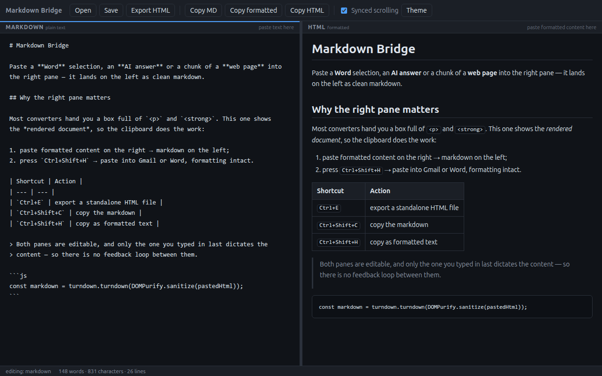

# Markdown Bridge

[](https://github.com/oscardias/markdown-bridge/actions/workflows/ci.yml)
[](LICENSE)

A side-by-side Markdown editor where the right pane is **formatted text, not tags**.

Most markdown ⇄ HTML tools convert to and from HTML *source* — you paste `<p>` and
`<strong>` in, you get `<p>` and `<strong>` out. But you rarely have the HTML. What you
have is the *content*: a paragraph from Word, an answer from an AI assistant, a chunk of
a web page. Markdown Bridge renders the right pane instead of printing it, so the
clipboard does the work in both directions — a plain copy and paste is the whole
workflow.



## What it is good for

- **AI output → repo docs.** Copy a formatted answer out of a chat, paste it on the
  right, get clean markdown on the left, save as `.md`.
- **Word or Google Docs → wiki.** Select in the document, paste on the right. Headings,
  bold, lists, links and tables survive; the styling noise does not.
- **Web page → notes.** Select part of a page, paste, keep the structure.
- **Markdown → email.** Write on the left, press `Ctrl+Shift+H`, paste into Gmail,
  Outlook or Word with the formatting intact.

Both panes are editable and stay in sync in both directions. Scrolling is mirrored
proportionally (and can be turned off).

## Install and run

Requires Node.js 20 or newer.

```bash
git clone https://github.com/oscardias/markdown-bridge.git
cd markdown-bridge
npm install
npm start
```

On Wayland sessions where Electron crashes on startup:

```bash
npm run start:x11    # electron --ozone-platform=x11 --disable-gpu .
```

Prebuilt binaries for Linux (AppImage, deb), Windows (installer, portable) and macOS
(dmg) are attached to each [release](https://github.com/oscardias/markdown-bridge/releases).
They are **not code-signed**, so macOS Gatekeeper and Windows SmartScreen will warn on
first launch.

## Shortcuts

| Shortcut | Action |
| --- | --- |
| `Ctrl+N` / `Ctrl+O` | new / open markdown |
| `Ctrl+S` / `Ctrl+Shift+S` | save / save as |
| `Ctrl+E` | export HTML (standalone, styled document) |
| `Ctrl+Shift+C` | copy markdown |
| `Ctrl+Shift+H` | copy **formatted** HTML (pastes with formatting into Word/Gmail) |
| `Ctrl+B` / `Ctrl+I` / `Ctrl+K` | bold / italic / link (markdown pane) |
| `Ctrl+D` | toggle light/dark theme |
| `Ctrl+L` | toggle synced scrolling |

Drag the middle divider to resize the panes; double-click resets it to 50/50.

Right-clicking either pane opens an editing menu — undo/redo, cut, copy, paste, select
all, plus the app's copy actions. Items are enabled to match the click context: cut needs
a selection *and* an editable field, copy only needs a selection, paste needs an editable
field *and* something on the clipboard, and "paste as plain text" only appears in the
HTML pane. Pasting through the menu goes through the same handling as the keyboard:
plain text in the markdown pane, sanitized HTML in the formatted one.

## How the sync works

Only one pane dictates the content at a time — whichever received the user's last edit:

- editing **markdown** → `marked` produces the HTML → sanitized by `DOMPurify` → preview;
- editing or pasting into **HTML** → `turndown` (+ GFM plugin) produces the markdown.

Because programmatic updates (`value` / `innerHTML`) do not fire an `input` event, there
is no feedback loop between the panes and no "I am updating" flag to keep in sync — and
the caret in the pane being edited is never moved by an update from the other side.

The markdown being edited is kept in `localStorage` as a draft and restored on launch.

## Project layout

| File | Role |
| --- | --- |
| [main.js](main.js) | main process: window, menus, file dialogs, IPC |
| [src/preload.js](src/preload.js) | the `window.api` bridge (contextIsolation on, no Node in the renderer) |
| [src/context-menu.js](src/context-menu.js) | right-click menu template (pure function, tested) |
| [src/index.html](src/index.html) | pane layout and library loading |
| [src/renderer.js](src/renderer.js) | conversion, sync, paste, copy, theme, divider |
| [src/styles.css](src/styles.css) | light/dark themes and preview typography |
| [scripts/screenshot.js](scripts/screenshot.js) | regenerates the README screenshots from the real app |
| [scripts/icon.js](scripts/icon.js) | renders `build/icon.png` from an inline SVG |
| [test/smoke.js](test/smoke.js) | end-to-end smoke test |

No build step, no framework, no bundler — the renderer loads `marked`, `turndown`,
`turndown-plugin-gfm` and `dompurify` as UMD files straight from `node_modules`.

## Tests

```bash
npm test          # or: npm run test:x11
```

The test opens the real window hidden and checks markdown → HTML, HTML → markdown,
formatted paste, plain-text paste, hostile-content sanitization and the context-menu
rules.

## Building

```bash
npm run dist          # every target for the current platform
npm run dist:linux    # AppImage + deb
npm run screenshot    # regenerate assets/screenshot-*.png
npm run icon          # regenerate build/icon.png
```

Artifacts land in `dist/`. Cross-platform builds run on tag pushes via
[the release workflow](.github/workflows/release.yml).

## Security

`nodeIntegration` off, `contextIsolation` on, a restrictive CSP, and every piece of HTML
— rendered or pasted — goes through `DOMPurify` before it reaches the preview: `script`,
`style`, `on*` handlers and `javascript:` URLs are stripped. External links open in the
default browser, never inside the app. See [SECURITY.md](SECURITY.md).

## Contributing

Bug reports and pull requests are welcome — see [CONTRIBUTING.md](CONTRIBUTING.md).

## License

[MIT](LICENSE) © Oscar Dias
