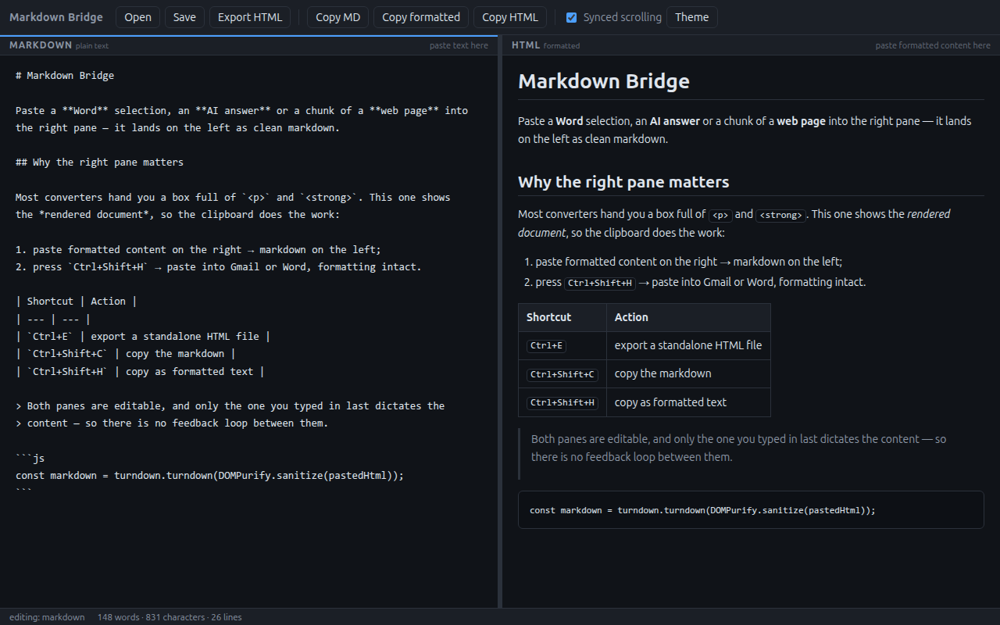

Toda vez que eu precisava tirar um texto de algum lugar e transformar em markdown, o
roteiro era o mesmo: abrir um conversor online, procurar onde colar, colar, e receber de
volta alguma coisa errada. Não porque o conversor fosse ruim — porque ele estava
resolvendo um problema que eu não tinha.

Os conversores markdown⇄HTML pedem **HTML**. Uma caixa de texto esperando `<p>`,
`<h2>`, `<strong>`. E eu quase nunca tenho HTML na mão. Tenho um parágrafo selecionado
num `.docx` que veio por e-mail, uma resposta de uma ferramenta de IA que quero guardar
na documentação do repositório, um pedaço de uma página que preciso levar para o wiki
interno. Conteúdo, não código-fonte.

O que acontece quando você tenta usar um com o outro é previsível. Você copia do Word e
cola na caixa: sai o texto cru, sem um único `#`, porque o campo aceitou só o
`text/plain`. Ou você vai em "exibir código-fonte" na página, copia a sopa de `<div>` do
site inteiro e cola: sai markdown com trinta linhas de lixo em volta do parágrafo que
você queria. Nos dois casos você termina formatando na mão o que a máquina deveria ter
feito.

O erro está antes da conversão. Está na caixa de entrada.

## A mudança: renderizar o outro lado

O [Markdown Bridge](https://github.com/oscardias/markdown-bridge) é um editor de dois
painéis, e a única decisão realmente importante nele é esta: **o painel da direita não
mostra o HTML, mostra o documento formatado**.



Parece uma escolha estética. É uma escolha de interface de entrada e saída, e ela muda os
dois gestos.

Na **entrada**, o painel da direita é um `contenteditable` — para o sistema operacional,
ele é um editor de texto rico, igual ao corpo de um e-mail. Então, quando você cola
alguma coisa ali, o clipboard entrega o `text/html`, que é o formato que todo aplicativo
decente coloca lá junto com o texto puro. Word, Google Docs, navegadores, clientes de
e-mail, interfaces de chat de IA: todos publicam `text/html`. Ele só costuma ser
ignorado, porque quase nenhum campo de texto sabe o que fazer com ele.

Aqui esse é justamente o insumo. Você seleciona no Word, dá Ctrl+C, clica na direita, dá
Ctrl+V — e o markdown aparece à esquerda, com títulos, negrito, listas, links e tabelas
preservados. Sem passar por "exportar", sem salvar arquivo intermediário, sem procurar
"ver código-fonte".

Na **saída**, o mesmo raciocínio ao contrário. `Ctrl+Shift+H` copia o painel direito como
texto formatado — o app escreve `text/html` **e** `text/plain` no clipboard de uma vez:

```js
await navigator.clipboard.write([
  new ClipboardItem({
    'text/html': new Blob([html], { type: 'text/html' }),
    'text/plain': new Blob([previewEl.innerText], { type: 'text/plain' }),
  }),
]);
```

Você cola no Gmail e chega formatado. Cola no Word e chega formatado. Cola num terminal e
chega texto limpo, porque quem recebe escolhe o formato que sabe ler. É o comportamento
que qualquer editor rico tem — e que nenhum conversor de markdown oferece, porque o
conteúdo deles é uma string de tags dentro de um `<textarea>`.

## Os três caminhos que eu realmente uso

**Resposta de IA → documentação.** As ferramentas de chat renderizam markdown na tela e,
quando você copia, entregam HTML no clipboard. Copiar direto para um arquivo `.md` costuma
perder a estrutura ou trazer artefatos da interface. Colar no painel direito devolve o
markdown de volta, limpo, pronto para commitar.

**Documento corporativo → wiki.** O `.docx` que circula por e-mail com títulos, listas e
uma tabela. Seleciona tudo, cola, salva como `.md`. O que sobrevive é a estrutura; o que
morre é o `font-family: Calibri` de cada parágrafo.

**Markdown → e-mail.** O caminho inverso, e o mais subestimado. Você escreve — ou já tem
no repositório — um texto em markdown, e precisa mandar para alguém que espera um e-mail
formatado, não `## assim`. Escreve à esquerda, `Ctrl+Shift+H`, cola no Outlook.

## Por dentro: o laço que não existe

Tecnicamente, o app é pequeno e sem cerimônia: Electron, sem framework, sem bundler, sem
etapa de build. [`marked`](https://marked.js.org) faz markdown → HTML,
[`turndown`](https://github.com/mixmark-io/turndown) com o plugin GFM faz HTML → markdown,
e [`DOMPurify`](https://github.com/cure53/DOMPurify) sanitiza tudo que entra.

O problema interessante de um editor com dois painéis editáveis não é a conversão — as
bibliotecas resolvem isso. É a **realimentação**. Se o markdown gera HTML e o HTML gera
markdown, o ciclo se fecha: cada atualização de um lado dispara a do outro, que dispara a
do primeiro. Na melhor das hipóteses o cursor pula; na pior o texto se degrada a cada
volta, porque nenhuma conversão de ida e volta é perfeitamente idempotente.

A solução usual é uma flag: `estouAtualizando = true`, faz a atualização,
`estouAtualizando = false`. Funciona, mas é o tipo de estado que envelhece mal — basta um
caminho assíncrono novo para a flag ficar presa e o app travar em silêncio.

Aqui a garantia vem de uma propriedade do DOM: **o evento `input` só nasce de edição do
usuário**. Escrever em `el.value` ou em `el.innerHTML` por código não dispara `input`
nenhum. Então o app só precisa marcar quem recebeu o último `input` e deixar que esse
painel dite o conteúdo:

```js
mdEl.addEventListener('input', () => {
  setSource('md');
  fromMarkdown();   // markdown → preview
});

previewEl.addEventListener('input', () => {
  setSource('html');
  fromHtml();       // preview → markdown
});
```

E as funções que atualizam o outro lado escrevem direto, sem cerimônia:

```js
const renderPreview  = () => { previewEl.innerHTML = toHtml(mdEl.value); };
const renderMarkdown = () => { mdEl.value = toMarkdown(previewEl.innerHTML); };
```

Nenhuma dessas duas linhas dispara `input`, então nenhuma delas devolve o controle para o
outro painel. O laço não é quebrado — ele nunca chega a existir. E, como consequência de
graça, o cursor de quem está digitando nunca é reposicionado por uma atualização vinda do
outro lado.

## Colar é sempre conteúdo de terceiros

Um app cuja função é receber conteúdo colado de qualquer lugar está, por definição,
processando entrada não confiável. O `text/html` do clipboard vem com `style` inline,
handlers `onclick`, às vezes `<script>` — a maior parte é sujeira de editor, mas basta um
caso não ser.

Por isso o `DOMPurify` está em **todos** os caminhos de entrada do preview, não só no da
colagem: markdown renderizado, HTML colado e HTML digitado à mão passam pelo mesmo filtro,
que remove `script`, `style`, `iframe`, atributos `on*` e URLs `javascript:`. Somado a
isso, `nodeIntegration` desligado, `contextIsolation` ligado, uma CSP com
`default-src 'none'` e links externos abrindo no navegador padrão, nunca dentro da janela.

O teste de fumaça verifica isso diretamente: ele cola um `<script>alert(1)</script>` e
renderiza um `[x](javascript:alert(1))`, e falha se qualquer um dos dois sobreviver.

## Está no ar

O Markdown Bridge é código aberto sob licença MIT, em
[github.com/oscardias/markdown-bridge](https://github.com/oscardias/markdown-bridge).
Tem binários para Linux, Windows e macOS nas releases, ou:

```bash
git clone https://github.com/oscardias/markdown-bridge.git
cd markdown-bridge
npm install
npm start
```

Issues e pull requests são bem-vindos — em especial relatos de colagem que dão errado. O
`text/html` que cada aplicativo publica no clipboard varia de um jeito que nenhuma
documentação cobre, e a única forma de melhorar essa parte é ver os casos reais.
